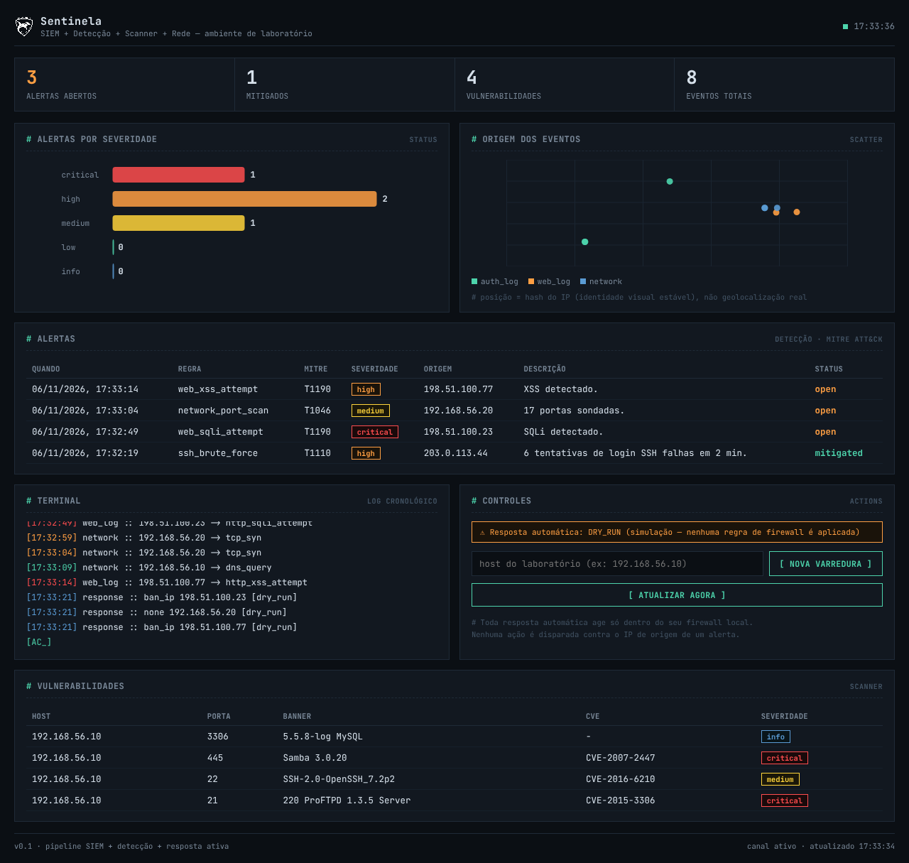

# Sentinela

Sistema de cibersegurança defensivo com 4 módulos: **SIEM** (coleta/normaliza
logs), **detecção** (regras mapeadas a MITRE ATT&CK), **scanner de
vulnerabilidades** (portas/CVE), e **monitoramento de rede** (captura de
pacotes ao vivo, estilo Wireshark), com **resposta ativa defensiva**
(bloqueio automático de IP no seu próprio firewall).



## Escopo e limite ético/legal

Este projeto é **só defensivo**. Ele **não** faz hack-back, contra-ataque,
ou qualquer ação ofensiva contra o IP de origem de um ataque. Os motivos:

1. **Legal**: invadir/atacar de volta é crime (Lei 12.737/2012 no Brasil),
   mesmo que você tenha sido atacado primeiro.
2. **Técnico**: IP de origem de ataque costuma ser falsificado ou é a
   máquina de uma vítima intermediária — "contra-atacar" acerta terceiros.

Toda resposta automática aqui age **dentro do seu próprio perímetro**
(seu firewall, seus hosts). Veja `backend/response/active_response.py`.

O sniffer de rede e o scanner só devem rodar contra **hosts e redes que
você tem autorização para testar** (sua VM/laboratório). Capturar tráfego
ou escanear rede de terceiros sem autorização também é crime. O scanner
**impõe** isso no código, não só promete no texto: `/api/scan` recusa
(HTTP 403) qualquer host que não resolva pra IP privado/loopback, a menos
que você rode com `SENTINELA_SCAN_ALLOW_PUBLIC=1` conscientemente.

## Segurança da API

A API não tem CORS aberto nem é anônima — sem isso, qualquer página aberta
no seu navegador poderia disparar ações nela (ex: um scan) sem você saber.

- **CORS** restrito a `localhost:8000`/`127.0.0.1:8000` (e `null`, origem
  que o navegador manda quando o dashboard é aberto como arquivo local).
- **Token obrigatório** (header `X-API-Key`) em todo endpoint `/api/*`.
  Gerado automaticamente na primeira subida e salvo em
  `backend/.sentinela_token` (gitignored — nunca commite esse arquivo).
  O dashboard busca o token sozinho via `/api/token`, que só responde a
  quem conecta de `localhost` — não precisa copiar nada manualmente.
- Pra fixar um token específico (ex: múltiplas máquinas), defina
  `SENTINELA_API_TOKEN` antes de subir o `uvicorn`.

Isso ainda **não é um sistema de login** — é o mínimo pra não deixar a
API 100% aberta num `localhost` que qualquer processo na sua máquina
alcança. Não exponha essa API além de `localhost` sem adicionar
autenticação de verdade.

## Arquitetura

```
backend/
  db.py                      # modelos (Event, Alert, Vulnerability, ResponseAction)
  main.py                    # API FastAPI + loop de detecção em background
  siem/collector.py          # lê logs (SSH, HTTP) e normaliza em Events
  detection/engine.py        # regras -> Alerts (MITRE ATT&CK)
  network/sniffer.py         # captura de pacotes (scapy) -> Events
  scanner/vuln_scanner.py    # varre portas/serviços -> Vulnerability (+ CVE via NVD)
  response/active_response.py # bloqueio de IP automático (dry-run por padrão)
frontend/
  index.html                 # dashboard (sem build step)
```

Todo módulo escreve no mesmo banco (`Event`, `Alert`, etc.), então a
detecção vê logs e tráfego de rede pela mesma lente.

## Windows: leia antes de instalar

O backend usa `iptables` e caminhos de log Linux (`/var/log/auth.log`) —
não funciona nativamente no Windows. Se seu notebook é Windows, use o
WSL2: passo a passo em **[docs/wsl2-setup.md](docs/wsl2-setup.md)**.

## Como rodar (ambiente de laboratório)

```bash
# libpcap é dependência de sistema do scapy p/ captura com filtro BPF —
# sem ela, run_sniffer() cai num modo sem filtro (mais lento, mas não
# falha silenciosamente; veja o aviso que ele imprime se isso acontecer)
sudo apt-get install -y libpcap0.8   # Debian/Ubuntu

cd backend
python3 -m venv .venv && source .venv/bin/activate
pip install -r requirements.txt
```

1. **API + dashboard:**
   ```bash
   uvicorn main:app --reload
   # abra frontend/index.html no navegador (aponta para localhost:8000)
   ```

2. **Coletor de log SSH** (processo separado, aponte para um auth.log real
   ou simulado):
   ```bash
   python3 -c "from siem.collector import run_collector; run_collector('/var/log/auth.log', 'ssh')"
   ```

3. **Sniffer de rede** (precisa de root/CAP_NET_RAW, e de scapy instalado —
   só na sua VM/lab):
   ```bash
   sudo python3 -c "from network.sniffer import run_sniffer; run_sniffer(interface='eth0', save_pcap='captura.pcap')"
   ```

4. **Scanner de vulnerabilidades** (via API, contra um host do seu lab):
   ```bash
   curl -X POST localhost:8000/api/scan -H "Content-Type: application/json" \
     -d '{"host": "192.168.56.10"}'
   ```

## Lab recomendado para gerar dados reais

Para o scanner e o SIEM terem o que detectar sem usar nada de terceiros:

- **Metasploitable2** ou **DVWA** como alvo vulnerável (VM/container isolado).
- **Kali Linux** (ou qualquer máquina na mesma rede isolada) para gerar
  tráfego de ataque simulado (ex: `hydra` contra SSH para testar a regra de
  brute force, `nmap` contra o próprio lab para testar a detecção de scan).

Nunca aponte o scanner, o sniffer ou os testes de ataque simulado para
hosts fora do seu laboratório controlado.

## Próximos passos sugeridos

- Trocar SQLite por Postgres (já há `SENTINELA_DB_URL` para isso).
- Autenticação no dashboard antes de expor fora de `localhost`.
- Mais regras de detecção (ex: impossible travel, beaconing C2).
- Dockerizar cada módulo (compose) para facilitar demo em entrevista.
